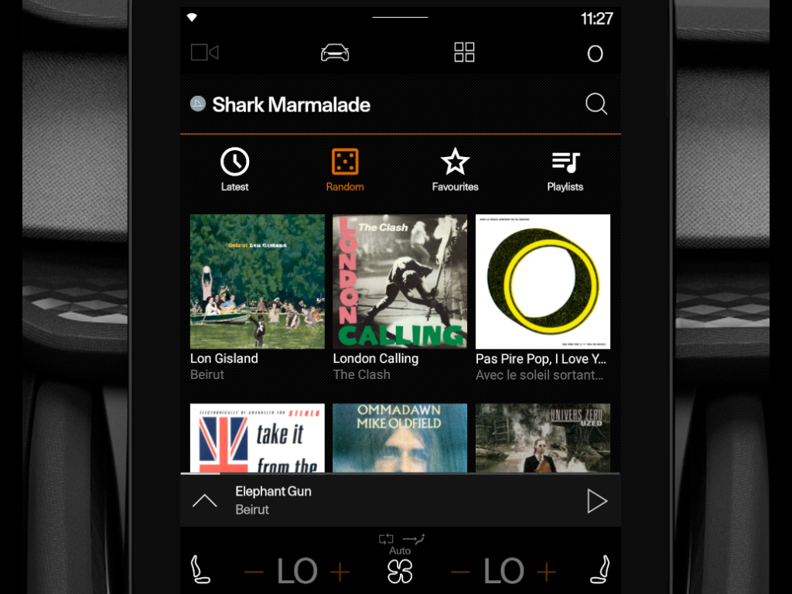

# Shark Marmalade

Shark Marmalade is a third-party music client for Jellyfin and Subsonic servers, targetting Android Automotive (AAOS).

## About the project

This is a client I wrote for myself, as at the time there was simply no option available. 
Shark Marmalade was the first AAOS media player for Jellyfin. 
It does exactly what I want it to do, and it's not intended to fit everyone's habits. 
It has an opinionated album-first approach.

I do not have a fancy AI-generated website for it, and I don't take financial contributions.
This is not even a hobby project, this is something I needed, so I made it. 

I published it on the play store because I had to (yes, you need to ask permission and pay a $25 fee to install your own software in your own car...).
I made it public because I figured other people might find it useful, and as a way of contributing back to the Jellyfin ecosystem which I've used for years.

In general, I don't intend to spend a lot of time maintaining the app beyond keeping it working, or developping features that I don't need myself.

That being said, if you would like to improve Shark Marmalade, PRs are more than welcome and I will happily help you if needed. 
I have no problem with AI-based contributions, as long as they are human-reviewable and maintainable.

## Known compatible cars

Please feel free to add to this list if you manage to use the app in your car! 

- Polestar 2
- Polestar 3
- Volvo XC90
- Volvo XC60
- Volvo XC40
- Volvo EX30
- Chevy Equinox EV
- Renault / Nissan OpenR Link vehicles

## Contributors

- @bendardenne
- @schredder
